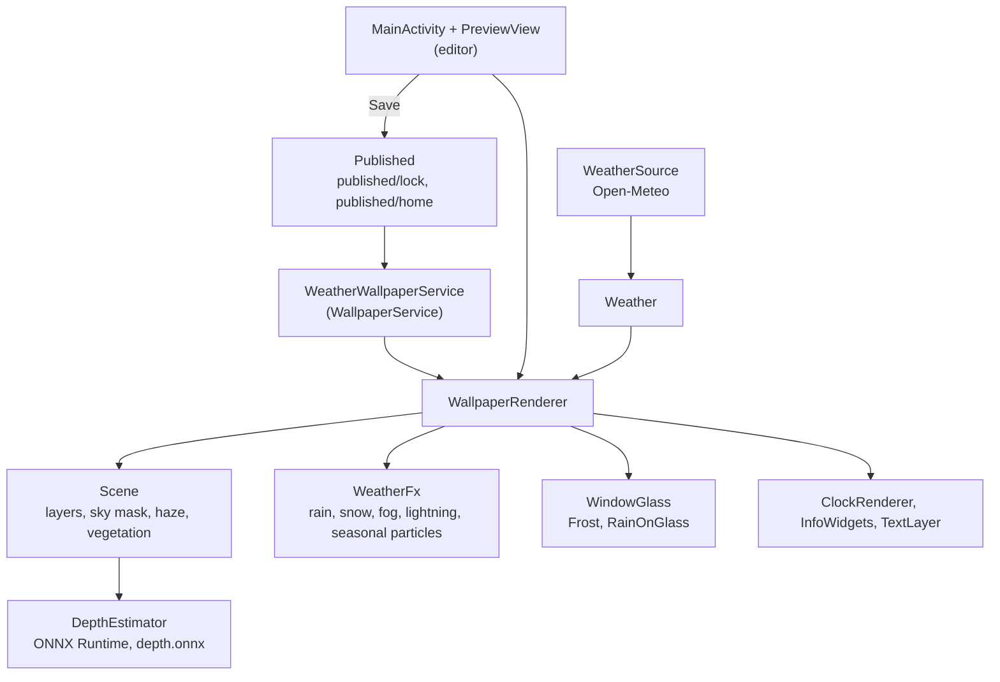
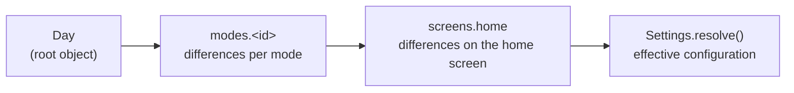

# Wetter Wallpaper

[](https://github.com/LegendeSamuel/WetterWallpaper/actions/workflows/ci.yml)

An Android live wallpaper that turns any photo into a scene with live weather, time of day and season, using on-device depth estimation to place the clock and effects between the layers of the photo.

> **Kurzfassung (Deutsch):** Android-Live-Wallpaper, das aus einem beliebigen Foto eine Wetterszene macht. Die App schätzt auf dem Gerät die Tiefe des Fotos (Depth Anything V2 Small über ONNX Runtime), trennt Himmel, Landschaft und Motiv und legt darüber das aktuelle Wetter von Open-Meteo, Tageszeit, Jahreszeit und frei gestaltbare Widgets. Das Foto verlässt das Gerät nicht. Entwickelt und getestet auf dem Samsung Galaxy S24 Ultra.

<!-- Screenshots / GIF: folgen nach Freigabe. -->

## Features

**Live weather**
- Current weather and air quality from [Open-Meteo](https://open-meteo.com/), based on the approximate location
- Particle systems for rain, snow, fog and thunderstorms
- Weather changes the photo only through colour grading, never by repainting it

**On-device depth**
- Depth estimation with *Depth Anything V2 Small* through ONNX Runtime; the photo is never uploaded
- Depth clustering, sky mask, haze and a vegetation layer are derived from the depth map
- The clock can sit behind the subject of the photo

**Window pane**
- A pane of glass in front of the scene, above the clock
- Frost ferns grow in from the edges below about 1 °C and cover the pane at −7 °C; the scene behind the frost is blurred (Android 12+)
- Raindrops act as lenses that show the photo upside down, run down in jerks and leave a trail; after the rain the pane dries in about three minutes

**Time of day and seasons**
- Sky by time of day with sun, moon and stars, blended softly into the photo
- Modes for day, dawn, dusk, night, a rain look and custom time ranges, switched by sun position or fixed times
- Four seasons with their own colour mood and particles (cherry blossom, autumn leaves)

**Editor**
- Full-screen preview, drag and drop, size and rotation with two fingers, snapping guides
- Text fills (colour, gradient, glass, photo), outline, shadow, glow, neon
- Colour picker with colours sampled from the photo
- Undo and redo, layer order, favourites that can be shared as a ZIP file
- Home screen and lock screen can be designed and saved separately (Android 14+)

**Widgets**
- Clock in several styles (including two-line and column)
- Date and weather, temperature, rain, hourly forecast, week, moon phase, sun arc, golden hour, stars, air quality, battery, countdown, next calendar event, time zone, free text

## Architecture



The same `WallpaperRenderer` draws the live wallpaper and the editor preview. The editor works on its own copy of the configuration; only "Save" copies it to the folder the wallpaper service reads, so editing never changes the running wallpaper.

Settings are stored in one `config.json` in layers. Each layer stores only what differs from the layer below:



## Technical decisions

**Image processing is plain Java, with no custom shaders.** Frost, rain on glass, edge refinement, the sky mask and the vegetation detection are plain Java classes without Android imports. They compile and run on a PC and are tested there (`tools/pc_harness` and the JUnit tests in CI), without a phone. Expensive results are computed once in the background and cached as bitmaps. Drawing uses a hardware-accelerated `Canvas`; the blur behind the frost uses `RenderNode` and `RenderEffect` and needs Android 12 or later.

**The debug build is not debuggable.** ART optimises debuggable apps far less, and the per-pixel loops of the scene computation then run two to three times slower (measured on a Galaxy S24 Ultra), which makes the app unpleasant to test. Logcat and `adb install` still work; attaching a debugger and `run-as` do not.

**arm64 only.** `abiFilters 'arm64-v8a'` keeps the ONNX Runtime native libraries to one ABI. The APK is already about 70 MB because of the 50 MB depth model.

**Weather data comes from Open-Meteo.** The app calls its forecast and air-quality endpoints without an API key or account. The requests carry the coordinates rounded to two decimal places (about 1 km); the app adds no other identifier. The data is licensed under CC BY 4.0, and the free API is limited to non-commercial use.

## Build

Requirements: JDK 17 or newer and the Android SDK (platform 36). The Gradle wrapper is included.

```bash
git clone https://github.com/LegendeSamuel/WetterWallpaper.git
cd WetterWallpaper
./gradlew assembleDebug          # Windows: gradlew.bat assembleDebug
adb install -r app/build/outputs/apk/debug/app-debug.apk
```

Gradle needs to know where the SDK is: either set `ANDROID_HOME`, or create `local.properties` with `sdk.dir=…` (Android Studio does this on first open). Then pick "Wetter Wallpaper" as live wallpaper in the system settings, or use "Save" in the app.

Tests run on the JVM, without a device:

```bash
./gradlew testDebugUnitTest
```

Notes:
- If the project folder is synced by OneDrive, OneDrive may lock `app/build`. Build with `./gradlew -I tools/outside-build.gradle assembleDebug`; the output then goes to `%LOCALAPPDATA%\WetterWallpaperBuild`.
- `tools/pc_harness/run.ps1` renders preview images of the image processing on a PC.

## Limits and known issues

- Tested only on a Samsung Galaxy S24 Ultra with One UI. Other devices and launchers are untested.
- arm64 devices only, Android 10 or newer. The blur behind the frost needs Android 12, saving home and lock screen separately needs Android 14.
- One UI does not allow hiding the system clock on the lock screen, so the wallpaper clock would appear in addition to it. Workaround: in Samsung Good Lock → LockStar, create a clock design, choose the weather element as "clock" and hide it.
- Computing the scene for a new photo takes several seconds on the S24 Ultra.
- Additional clocks have no format options yet, and an additional "date and weather" widget is always a single line.
- The user interface is in German only.

## License and acknowledgements

The code is released under the [MIT License](LICENSE).

- [ONNX Runtime](https://github.com/microsoft/onnxruntime) (MIT)
- [Depth Anything V2 Small](https://github.com/DepthAnything/Depth-Anything-V2) by Lihe Yang et al. (Apache-2.0), ONNX export from [onnx-community](https://huggingface.co/onnx-community/depth-anything-v2-small)
- Weather data by [Open-Meteo.com](https://open-meteo.com/) (CC BY 4.0)
- [Lexend](https://github.com/googlefonts/lexend) font (SIL OFL 1.1)
- AndroidX and Material Components for Android (Apache-2.0)

Details, versions and licence texts: [THIRD_PARTY_NOTICES.md](THIRD_PARTY_NOTICES.md).

For contributors and coding agents: [AGENTS.md](AGENTS.md) describes the architecture and build rules in German, [ACTIVE_STATE.md](ACTIVE_STATE.md) is the working log.
